<p align="center">
  
</p>

# 🎙️ Awesome Meeting Intelligence & AI Transcription 🤖

<p align="center">
  <a href="https://github.com/ishandutta2007/Awesome-Awesome-Awesome"></a><a href="https://discord.gg/jc4xtF58Ve"></a>
  <a href="https://github.com/ishandutta2007/Awesome-Awesome-Awesome"></a>
  <a href="https://www.trackawesomelist.com"></a>
  <a href="http://makeapullrequest.com"></a>
  <a href="LICENSE"></a>
  <a href="https://github.com/ishandutta2007"></a>
</p>

> 🌟 A comprehensive, community-curated directory of premier **SaaS meeting intelligence platforms**, **on-device AI meeting note takers**, **speech-to-text (STT) bots**, and **open-source meeting transcription tools**.

Meeting intelligence software captures, transcribes, summarizes, and extracts actionable insights, tasks, and follow-ups from Zoom, Google Meet, Microsoft Teams, Webex, and in-person discussions. Whether you need an enterprise-grade conversation intelligence suite or a privacy-first, on-device open-source note-taker powered by Whisper, Parakeet, or local LLMs without invasive meeting bots, this directory tracks the best available options.

---

## 📑 Table of Contents

- [📊 Sector Overview & Market Dynamics](#-sector-overview--market-dynamics)
- [☁️ SaaS / Hosted Meeting Intelligence Platforms](#️-saas--hosted-meeting-intelligence-platforms)
- [💻 Open-Source Meeting Intelligence & Transcription Projects](#-open-source-meeting-intelligence--transcription-projects)
- [🔍 Key Selection Criteria](#-key-selection-criteria)
- [🤝 How to Contribute](#-how-to-contribute)
- [📈 Star History](#-star-history)
- [💖 Support & Sponsor](#-support--sponsor)
- [⚖️ License](#️-license)

---

## 📊 Sector Overview & Market Dynamics

📈 The global **AI Meeting Assistant & Meeting Intelligence** market is valued at approximately **$3.3B–$3.5B in 2025** and is projected to surpass **$21B+ by the early 2030s**, expanding at a blistering CAGR of **25% to 44%** as enterprise workforces normalize hybrid workflows.

🌐 The sector is **moderately to highly fragmented** rather than a "winner-take-all" monopoly: while platform giants (Microsoft Teams Copilot, Zoom AI Companion, Google Gemini Workspace) bundle basic summarization natively, an extensive landscape of specialized point solutions (Otter, Fireflies, Fathom, Read AI, Avoma) aggressively captures market share through advanced CRM field sync, automated sales coaching, cross-meeting knowledge graphs, and privacy-first local recording alternatives.

---

## ☁️ SaaS / Hosted Meeting Intelligence Platforms

Sorted in descending order by **Company Scale (Valuation / Estimated ARR / Funding)**:

| Platform | 💳 Pricing (Starting Tier) | 🎁 Free Tier Limit / Trial Plan | 🏢 Company Scale (Valuation / Revenue) | 🚀 Key Features & Core Focus |
| :--- | :--- | :--- | :--- | :--- |
| **[Fireflies.ai](https://fireflies.ai)** | **$10.00** /user/month (billed annually; $18 monthly) | **Free Forever**: 400 min storage/team, 20 AI summary credits, unlimited transcription, 100+ languages | **$1.0B Valuation** (~$10M+ ARR) | Multi-platform meeting bot (Zoom, Meet, Teams), topic trackers, soundbites, automated CRM & Slack sync. |
| **[Read AI](https://www.read.ai)** | **$15.00** /user/month (billed annually; $19.75 monthly) | **Free Forever**: 5 meeting reports/month (up to 1 hr/meeting), messaging & email digest summaries | **$450M Valuation** (Series B, $50M round, ~$5M+ ARR) | Cross-platform meeting/email/chat intelligence, engagement scoring, sentiment analytics, and team playback. |
| **[Otter.ai](https://otter.ai)** | **$8.33** /user/month (billed annually; $16.99 monthly) | **Free Forever**: 300 minutes/month (30 min/conversation cap), 3 lifetime file uploads | **$100M+ ARR** (~$63M funding raised) | OtterPilot auto-joins Zoom, Meet & Teams; live automated transcription, speaker tags, automated slide capture. |
| **[Fathom](https://fathom.video)** | **$15.00** /user/month (billed annually; Team edition, 2 user min; $16 solo) | **Free Forever**: 100% unlimited recording & transcription storage; AI summaries limited to first 5 calls/month | **$73M Valuation** (~$30M+ ARR) | Product-led growth favorite; zero storage limits on raw transcripts, instant AI highlights, HubSpot/Salesforce sync. |
| **[Fellow.app](https://fellow.app)** | **$7.00** /user/month (billed annually; $11 monthly) | **Free Forever**: Unlimited collaborative meeting agendas; lifetime pool of 5 AI meeting note recordings | **$24M+ Raised** (~$10M–$15M ARR range) | All-in-one meeting governance, 1-on-1 feedback frameworks, AI-generated action items, 50+ tool integrations. |
| **[Avoma](https://www.avoma.com)** | **$19.00** /recorder/month (billed annually; $24 monthly) | **14-Day Free Trial**: Full access to Organization tier recording & AI summaries (viewers/collaborators are $0) | **$15M+ Raised** (~$10M+ ARR range) | Full conversation & revenue intelligence suite; automated meeting lifecycle, CRM sync, deal risk signals. |
| **[tl;dv](https://tldv.io)** | **$18.00** /user/month (billed annually; $25 monthly) | **Free Forever**: Unlimited meeting video recording & transcription; AI summaries capped at 10/month | **$5M+ Raised** (High-growth European scale-up) | Ultra-fast video clips, automated multi-language meeting minutes, Zapier/Notion/HubSpot workflows. |
| **[Supernormal](https://supernormal.com)** | **$10.00** /user/month (billed annually; $18 monthly) | **Free Forever**: Credit-based free tier; 1,000 monthly credits (~5 to 10 AI summarized meetings) | **$10M+ Raised** (~$3M–$5M ARR range) | Automated instant notes, executive summaries, multi-template customization, and customizable follow-up emails. |
| **[MeetGeek](https://meetgeek.ai)** | **$9.99** /user/month (billed annually; $12 monthly) | **Free Forever**: 3 hours transcription/month, 3 months transcript storage, automated summary emails | **Bootstrapped / Seed** (~$2M–$4M ARR range) | Automated call recordings, meeting KPI tracking, team performance scores, repository of team video highlights. |
| **[Sembly AI](https://www.sembly.ai)** | **$10.00** /user/month (billed annually; $15 monthly) | **7-Day Free Trial**: 4 hours of recording, then reverts to Personal limited preview tier | **$23M Valuation** (Crowdfunding/Seed, ~$1M–$3M ARR) | "Sembly Agent" attends calls without you, generates multi-speaker action items, risk indicators, and task lists. |

---

## 💻 Open-Source Meeting Intelligence & Transcription Projects

Sorted in descending order by **GitHub Star Count**:

| Project | ⭐ Stars | 🛠️ Platform / Stack | 📖 Description & Open-Source Highlights |
| :--- | :---: | :--- | :--- |
| **[Zackriya-Solutions/meetily](https://github.com/Zackriya-Solutions/meetily)** | [](https://github.com/Zackriya-Solutions/meetily/stargazers) | Windows, macOS, Linux | Privacy-first AI meeting note taker. Completely on-device Whisper & NVIDIA Parakeet transcription with local speaker diarization; records directly from system audio without requiring an invasive meeting bot. |
| **[leits/MeetingBar](https://github.com/leits/MeetingBar)** | [](https://github.com/leits/MeetingBar/stargazers) | macOS (Swift) | Open-source macOS menu bar utility that aggregates 30+ meeting services (Zoom, Google Meet, Teams, Webex) to launch, join, and orchestrate calls in one click. |
| **[FrigadeHQ/yogurt](https://github.com/FrigadeHQ/yogurt)** | [](https://github.com/FrigadeHQ/yogurt/stargazers) | macOS, Windows, Linux (Electron, Rust) | Private AI meeting notes that stay on your computer. Fully local alternative to Granola, Otter, and Fireflies with no meeting bot and zero audio streamed to 3rd-party clouds. |
| **[Natively-AI-assistant/natively-cluely-ai-assistant](https://github.com/Natively-AI-assistant/natively-cluely-ai-assistant)** | [](https://github.com/Natively-AI-assistant/natively-cluely-ai-assistant/stargazers) | Cross-Platform (Desktop) | Free open-source AI meeting assistant, interview copilot, and lecture note taker with real-time transcription, local RAG, BYOK (Bring Your Own Key), and stealth mode. |
| **[Vexa-ai/vexa](https://github.com/Vexa-ai/vexa)** | [](https://github.com/Vexa-ai/vexa/stargazers) | Python, Go, Docker | Open-source meeting transcription API for Google Meet, Microsoft Teams & Zoom. Provides headless auto-joining meeting bots, real-time WebSocket transcripts, and MCP server for AI agents. |
| **[yazinsai/OpenOats](https://github.com/yazinsai/OpenOats)** | [](https://github.com/yazinsai/OpenOats/stargazers) | macOS (Swift) | Minimalist meeting recorder and summarizer for Mac. Press Start, and upon Stop generates clean Markdown notes and structured transcripts using local on-device Whisper models. |
| **[video-db/call.md](https://github.com/video-db/call.md)** | [](https://github.com/video-db/call.md/stargazers) | Node.js, Python | Turn meetings into live agent loops. Records, transcribes, and analyzes meetings with real-time AI intelligence before, during, and after calls. |
| **[Muesli-HQ/muesli](https://github.com/Muesli-HQ/muesli)** | [](https://github.com/Muesli-HQ/muesli/stargazers) | macOS (Swift) | Agent-native local meeting transcription and dictation workspace for macOS (Granola, WisprFlow, and Littlebird alternative). |
| **[attendee-labs/attendee](https://github.com/attendee-labs/attendee)** | [](https://github.com/attendee-labs/attendee/stargazers) | TypeScript, Node.js, Docker | The universal open-source meeting bot infrastructure API. Spin up containerized headless bots that join Google Meet, Zoom, and Teams calls with raw audio capture. |
| **[RecapAI/Recap](https://github.com/RecapAI/Recap)** | [](https://github.com/RecapAI/Recap/stargazers) | macOS (Swift) | Open-source, privacy-first, macOS-native AI meeting summarizer with automatic local recording, Whisper transcription, and local LLM summarization. |
| **[joinly-ai/joinly](https://github.com/joinly-ai/joinly)** | [](https://github.com/joinly-ai/joinly/stargazers) | Python, TypeScript | Make meetings accessible to AI agents. Connects calendar invites, sends automated bots to capture audio/video streams, and exposes live transcript endpoints. |
| **[scosman/Biscotti](https://github.com/scosman/Biscotti)** | [](https://github.com/scosman/Biscotti/stargazers) | macOS (Swift) | Free, private, lightweight meeting transcription app for macOS with local Whisper model execution and fast export options. |
| **[jankeesvw/omarchy-meeting-recorder](https://github.com/jankeesvw/omarchy-meeting-recorder)** | [](https://github.com/jankeesvw/omarchy-meeting-recorder/stargazers) | Python, Electron | Dual-track local meeting recorder capturing mic and system loopback audio separately, with offline Whisper transcription, speaker identification, and interactive timeline. |
| **[infiniV/VoiceFlow](https://github.com/infiniV/VoiceFlow)** | [](https://github.com/infiniV/VoiceFlow/stargazers) | Windows, Linux (Python) | Local voice dictation and meeting recorder for desktop. Hold a hotkey to transcribe system audio + microphone inputs with Whisper and generate bring-your-own-LLM summaries. |
| **[meetingbot/meetingbot](https://github.com/meetingbot/meetingbot)** | [](https://github.com/meetingbot/meetingbot/stargazers) | TypeScript, Puppeteer | Open-source meeting bot infrastructure that automatically connects to Google Meet and Zoom, streams raw audio, and triggers transcription webhooks. |
| **[Knuckles92/OpenWhisper](https://github.com/Knuckles92/OpenWhisper)** | [](https://github.com/Knuckles92/OpenWhisper/stargazers) | Windows, macOS, Linux | Local-first desktop suite for audio transcription, meeting notes, and dictation. Supports Parakeet, Whisper, Qwen-ASR, or cloud APIs with LAN engine sharing and MCP support. |
| **[pasrom/meeting-transcriber](https://github.com/pasrom/meeting-transcriber)** | [](https://github.com/pasrom/meeting-transcriber/stargazers) | macOS (Python, Swift) | On-device meeting transcriber for macOS that auto-records Teams, Zoom, and Webex, transcribes speech, and separates speakers locally with zero cloud data transfer. |
| **[ZapYap-com/note67](https://github.com/ZapYap-com/note67)** | [](https://github.com/ZapYap-com/note67/stargazers) | TypeScript, Tauri | Private, local meeting notes assistant. Captures system audio, transcribes locally with Whisper, and generates AI-powered summaries on device. |
| **[rajpdus/MeetingSummarizer](https://github.com/rajpdus/MeetingSummarizer)** | [](https://github.com/rajpdus/MeetingSummarizer/stargazers) | Python, PyQt | Desktop utility powered by OpenAI Whisper and GPT to record audio, parse transcripts, and produce structured meeting executive summaries. |
| **[screenappai/meeting-bot](https://github.com/screenappai/meeting-bot)** | [](https://github.com/screenappai/meeting-bot/stargazers) | Docker, Node.js | Universal open-source meeting bot to record Google Meet, Zoom, and Teams meetings with a unified REST/WebSocket API. |
| **[dhruvldrp9/Google-Meet-Bot](https://github.com/dhruvldrp9/Google-Meet-Bot)** | [](https://github.com/dhruvldrp9/Google-Meet-Bot/stargazers) | Python, Selenium | Automated Python bot that logs into Google Meet, records call audio, and generates key takeaways, action points, and sentiment analysis. |
| **[amicalhq/prismical](https://github.com/amicalhq/prismical)** | [](https://github.com/amicalhq/prismical/stargazers) | TypeScript, Next.js | Free, privacy-preserving AI note taker for transcribing meetings, lectures, and voice notes with local AI and no invasive bot attendance. |

---

## 🔍 Key Selection Criteria

When choosing between hosted SaaS solutions and open-source meeting intelligence systems, evaluate:

1. 🤖 **Bot vs. Botless Architecture**:
   - *Meeting Bot (e.g., Fireflies, Otter, Vexa, Attendee)*: Joins the video conference call as a virtual participant. Great for multi-person remote meetings and team-wide recording permission clarity.
   - *Botless / Local Audio Loopback (e.g., Meetily, Yogurt, Biscotti)*: Captures microphone and system output directly on your machine. Highly discrete, operates in stealth, and requires no external bot invitations.
2. 🔒 **Data Privacy & Compliance (HIPAA, SOC 2, GDPR)**:
   - If conversations contain sensitive financial, medical, or confidential proprietary data, on-device tools (`Meetily`, `Yogurt`, `OpenWhisper`) ensure that zero audio leaves your hardware.
3. 🎙️ **Speaker Diarization & Audio Quality**:
   - Multi-speaker recognition requires accurate diarization models (e.g., PyAnnote, NVIDIA NeMo/Parakeet). Dual-track loopback recording isolates user audio from remote attendees for higher accuracy.
4. ⚡ **Action Item Automation & CRM Integration**:
   - For sales and revenue teams, automated bi-directional syncing into Salesforce, HubSpot, or Slack (`Fathom`, `Avoma`, `Read AI`) saves hours of manual administrative CRM logging.

---

## 🤝 How to Contribute

Contributions are welcome! If you know of an awesome open-source meeting intelligence repo or notable platform:

1. 🍴 Fork this repository.
2. ✍️ Add your tool to the corresponding section with factual metrics and links.
3. ⭐ For open-source projects, ensure the badge points to the repository's stargazers page:
   ```markdown
   [](https://github.com/<owner>/<repo>/stargazers)
   ```
4. 🚀 Open a clean pull request with a descriptive title.

---

## 📈 Star History

##  Star History
#[](https://star-history.dera.page/#ishandutta2007/Awesome-Meeting-Intelligence-AI-Transcription&type=date&legend=top-left)`
[](https://www.star-history.com/#ishandutta2007/Awesome-Meeting-Intelligence-AI-Transcription&type=date&legend=top-left)`

---

## 💖 Support & Sponsor

A huge **thank you** for checking out and using this curated directory! If you find this meeting intelligence tracker helpful, please consider supporting the project:

- ⭐ **Star this repository** to help others discover it across GitHub.
- 🍴 **Fork and contribute** to keep entries, tool features, and benchmarks up to date.
- 📢 **Share with friends and colleagues** across your engineering, product, or sales teams.
- ☕ **Buy me a coffee / Sponsor**: Support continuous maintenance, curation, and development via the [GitHub Sponsors Dashboard](https://github.com/sponsors/ishandutta2007).

---

## ⚖️ License

This project is licensed under the [MIT License](LICENSE).
